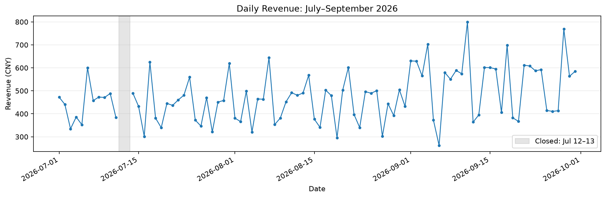
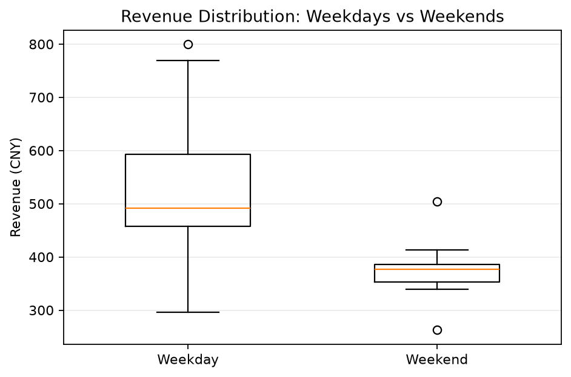
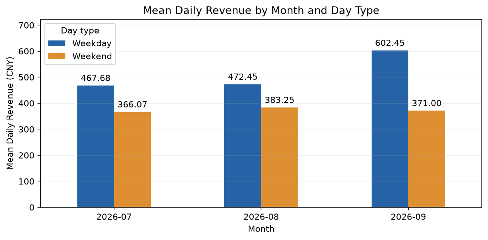
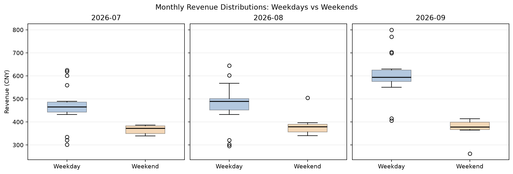
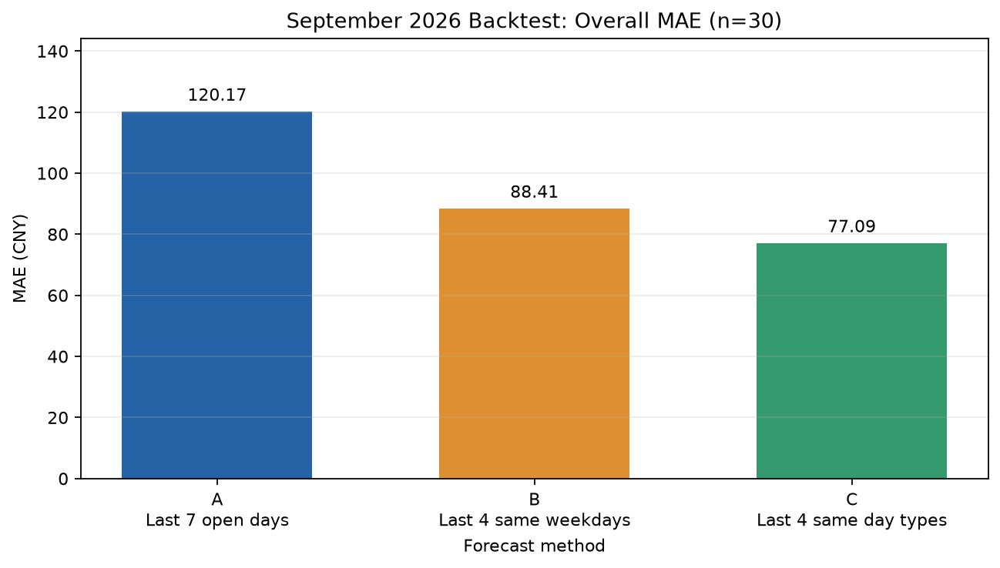

# Breakfast Shop Revenue Analysis & Forecasting

A personal applied data science project using **90 operating days** of recorded revenue from a family breakfast shop in Ningbo, China, from July to September 2026. Python, pandas and matplotlib are used to explore income patterns and evaluate three simple historical-average forecasting methods.

Revenue includes actual electronic receipts and estimated cash, **excludes Alipay**, and is measured in CNY. The analysis preserves the original amounts. [Data definitions and limitations](data/README.md).

## Questions

1. How does daily revenue vary, and how do weekday and weekend distributions differ?
2. Is September's revenue growth concentrated on weekdays?
3. How accurately do three simple methods predict September's daily recorded revenue when only earlier observations are available?

## Run the project

The complete analysis and backtest are in **one file: `analysis.py`**. No append-only script is needed. Open this folder in PyCharm, select a Python interpreter, install the requirements in its Terminal, and run `analysis.py`.

```bash
python -m pip install -r requirements.txt
python analysis.py
```

To save all five figures and CSV tables without opening plot windows:

```bash
python analysis.py --no-show
```

Paths are resolved relative to the script, so changing the working directory does not change input or output locations. The script saves every result before a single final `plt.show()`; the first four figures do not block the backtest. Tested with Python 3.14.6 and the package versions in `requirements.txt`.

## Files

| Path | Contents |
|---|---|
| `analysis.py` | Complete analysis and chronological backtest, with Chinese comments |
| `data/revenue_2026_07_09.csv` | Original 90 date/revenue records |
| `data/README.md` | Data definitions, closures and revenue scope |
| `figures/` | Four descriptive figures and one MAE figure |
| `results/` | Descriptive tables, daily predictions and grouped MAE |
| `verify_results.py` | Independent checks of saved outputs and forecasting histories |

## Descriptive results

| Month | Operating days | Recorded total (CNY) | Daily mean (CNY) |
|---|---:|---:|---:|
| July | 29 | 12,851.50 | 443.16 |
| August | 31 | 13,754.00 | 443.68 |
| September | 30 | 16,222.00 | 540.73 |

Compared with pooled July–August daily records, September's weekday mean increased from **470.01 to 602.45 CNY (+28.18%)**. Its weekend mean changed from **376.18 to 371.00 CNY (−1.38%)**. These describe the observed groups; they do not establish a cause.

The July–August baseline is calculated directly from the relevant daily records, not an unweighted average of the two monthly means. Weekdays are Monday–Friday and weekends are Saturday–Sunday, without holiday or adjusted-workday corrections.

### 1. Daily revenue



The full calendar contains 92 days. The two closed dates remain missing for plotting and are not counted in operating-day means.

### 2. Overall weekday/weekend distributions



All supplied observations, including high and low values, are retained. The descriptive table includes counts, means, medians and sample standard deviations (`ddof=1`).

### 3. Monthly weekday/weekend means



### 4. Monthly weekday/weekend distributions



## Historical forecasting backtest

Every September operating day is predicted using observations strictly before its date. Only after the predictions are computed is that day's recorded revenue added to the history available for the next prediction.

| Method | Historical sample |
|---|---|
| A | Most recent 7 operating days |
| B | Most recent 4 operating days with the same weekday (e.g. four Tuesdays) |
| C | Most recent 4 operating days with the same day type (weekday or weekend) |

Each method uses the mean of its selected sample. Insufficient history produces a missing prediction and an explicit status. Methods are compared only on dates where all three have predictions. Assertions check that every selected date precedes the prediction date; the prediction CSV also records the exact history dates.

For this dataset, all **30 September dates** are comparable: **22 weekdays and 8 weekend days**. MAE is the average absolute difference between a prediction and the actual recorded value; those recorded values still include estimated cash.

| Method | Overall MAE (CNY) | Weekday MAE (CNY) | Weekend MAE (CNY) |
|---|---:|---:|---:|
| A | 120.17 | 106.33 | 158.21 |
| B | 88.41 | 108.61 | 32.86 |
| C | 77.09 | 90.52 | 40.16 |

### 5. Overall MAE



Method C has the lowest overall MAE in this historical test, while method B has the lowest weekend MAE. This does not establish that any method is universally best or will perform best on future data. MAE is an average error, not a guaranteed interval around a future prediction.

## Output tables

- [Monthly totals](results/monthly_summary.csv)
- [Overall weekday/weekend statistics](results/overall_day_type_stats.csv)
- [Monthly weekday/weekend statistics](results/monthly_day_type_stats.csv)
- [September versus pooled July–August](results/september_vs_july_august.csv)
- [Daily predictions and historical-date audit](results/daily_revenue_backtest_predictions.csv)
- [Overall, weekday and weekend MAE](results/daily_revenue_backtest_mae.csv)

CSV files retain unrounded calculations and use UTF-8 with BOM for compatibility with Excel. README and chart labels round values for display only.

After running the analysis, check saved results with:

```bash
python verify_results.py
```

## Limitations and interpretation

- One shop and three months of data limit generalization.
- Estimated cash and omitted Alipay receipts affect the meaning and precision of recorded revenue. The cash-estimation procedure is not documented in the supplied material.
- Work, school and September reopening are hypotheses about demand, not demonstrated causes of the observed pattern.
- Weather, customer counts, prices, product mix, hours and holiday calendars are not included.
- September was explored before the forecasting comparison was developed. Chronological data checks prevent future observations entering each prediction, but new unseen dates are still needed for prospective validation.
- Revenue is not profit, demand quantity, or a direct measure of how much food to prepare. Improved revenue, reduced waste and actual adoption by the shop have not been measured.
- This project uses simple historical-average methods, with no machine-learning model and no predictions for dates after September 30.

Implementation note: AI tools assisted with code development and debugging. The repository records the methods and outputs so they can be inspected and reproduced.

## 中文使用说明

只需运行 `analysis.py` 一个文件。原始数据在 `data/`，五张图片在 `figures/`，统计表与预测 CSV 在 `results/`。图片会先全部保存，再统一弹窗显示；加 `--no-show` 则只保存不弹窗。

本项目保留全部原始金额；实际记录值含估算现金、未含支付宝。7 月 12、13 日停业不填零、不插值。结果描述相关变化，不将开学认定为原因，也不声称已改善经营收益。
